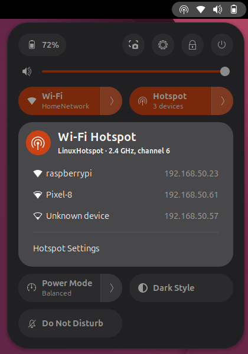

# Linux Mobile Hotspot

Share your laptop's Wi-Fi connection as a hotspot **without disconnecting from Wi-Fi**, using the single
wireless card you already have. It works like the Mobile hotspot feature in Windows: the laptop stays online,
and your phone, tablet, second laptop or development board connects to it.



## Features

- **Hotspot and Wi-Fi at the same time** on one wireless card, where the card supports it.
- **One-click toggle** in the GNOME system menu, right next to Wi-Fi, with a list of connected devices.
- **Desktop app** with hotspot status, connected devices (name, IP address, signal, data used) and settings.
- **Command-line tool** for terminals, scripts and headless machines.
- **Built-in compatibility check** that tells you in seconds whether your Wi-Fi card can do this.
- WPA2, WPA3 or mixed security, on 2.4 GHz or 5 GHz.

Typical uses: getting a phone or tablet online through your laptop, giving a Raspberry Pi or Jetson board
internet access while you work on it over SSH, or connecting devices that cannot open a Wi-Fi sign-in page
through a network the laptop has already signed in to.

## Will it work on my computer?

Two things decide this.

**1. Your Wi-Fi card.** It has to support running a hotspot and a normal Wi-Fi connection at the same time.
Many Intel, MediaTek and Qualcomm Atheros cards do, and usually the built-in Wi-Fi of the Raspberry Pi 3, 4
and 5 as well. Broadcom cards that use the proprietary `wl` driver do not. You do not need to guess: Step 2 below
runs a check that gives a definite answer.

**2. Your Linux distribution and desktop.**

| Distribution | Command-line tool | Desktop app | GNOME top-bar toggle |
|---|---|---|---|
| Ubuntu 24.04 to 26.04 | Yes | Yes | Yes |
| Ubuntu 22.04 | Yes | No | No |
| Debian 13 | Yes | Yes | Yes |
| Debian 12, Raspberry Pi OS | Yes | Yes | No |
| Fedora Workstation 39 to 44 | Yes | Yes | Yes |
| RHEL, AlmaLinux, Rocky Linux 10 | Yes | Yes | Yes |
| RHEL, AlmaLinux, Rocky Linux 9 | Yes | If libadwaita 1.2+ is available | No |
| Arch Linux, Manjaro, EndeavourOS | Yes | Yes | With GNOME 45 to 50 |
| openSUSE Tumbleweed, Leap 15.6 and later | Yes | Yes | With GNOME 45 to 50 |
| Linux Mint 22, Pop!_OS 24.04, KDE Plasma, Xfce, Cinnamon | Yes | Yes | No (GNOME only) |

The desktop app requires libadwaita 1.2 or newer, and the toggle requires GNOME Shell 45 to 50. The project
is tested on Ubuntu 26.04 with GNOME 50 and an Intel Wi-Fi card; the other rows follow from the package and
library versions those systems ship. Reports from other systems are very welcome.

## Installation

### Step 1: Download

Open a terminal (on Ubuntu: <kbd>Ctrl</kbd>+<kbd>Alt</kbd>+<kbd>T</kbd>) and run:

```sh
git clone https://github.com/rajmehta28599/linux-mobile-hotspot.git
cd linux-mobile-hotspot
```

If `git` is not installed, either install it (`sudo apt install git` on Ubuntu and Debian) or use
**Code > Download ZIP** on this page, extract the archive and open a terminal in the extracted folder.

### Step 2: Check your Wi-Fi card

```sh
./wifi-hotspot check
```

This only reads information; it changes nothing and needs no password. If it reports that `iw` is missing,
install it and run the check again:

| Distribution | Command |
|---|---|
| Ubuntu, Debian, Linux Mint, Pop!_OS, Raspberry Pi OS | `sudo apt install iw` |
| Fedora, RHEL, AlmaLinux, Rocky Linux | `sudo dnf install iw` |
| Arch Linux, Manjaro, EndeavourOS | `sudo pacman -S iw` |
| openSUSE | `sudo zypper install iw` |

Then read the last line of the output:

- **`Your system is supported.`** Continue with Step 3.
- **`N check(s) failed.`** The lines marked `[FAIL]` explain why. The usual reason is a card that cannot run a
  hotspot while it is connected to Wi-Fi; a USB Wi-Fi adapter with access point support solves that.

### Step 3: Install

Pick the line that matches your desktop. The installer asks for your password when it needs administrator
rights.

```sh
./install.sh --gnome    # GNOME desktops (Ubuntu, Fedora Workstation, ...): tool, app and top-bar toggle
./install.sh --gui      # other desktops: tool and app
./install.sh            # servers and terminal-only use: tool only
```

The installer:

1. installs any missing packages with your package manager (apt, dnf, pacman or zypper),
2. copies the programs to `/usr/local/bin`,
3. creates your settings file with a random hotspot password and prints that password once,
4. runs the compatibility check again.

Prefer to install everything yourself? See [Manual installation](#manual-installation).

### Step 4: Log out and back in (GNOME only)

GNOME loads new top-bar items only when you log in, so log out and back in once. Afterwards, the **Hotspot**
toggle appears in the system menu in the top-right corner, next to Wi-Fi.

### Step 5: Choose the hotspot name and password

The installer has already set a random password. To choose your own name and password, use either:

- the desktop app: open **Wi-Fi Hotspot** from the application menu and click the gear icon, or
- the terminal: `wifi-hotspot config`, then edit `SSID` and `PASSWORD` and save.

The password needs 8 to 63 characters. The app and the toggle refuse to start while the password is still the
placeholder from the example settings file.

### Step 6: Turn the hotspot on

Use whichever you prefer:

| Where | How |
|---|---|
| Top bar (GNOME) | Open the system menu in the top-right corner and click **Hotspot** |
| Desktop app | Open **Wi-Fi Hotspot** and click **Start** |
| Terminal | `wifi-hotspot start` |

You are asked for your login password each time (in a dialog, or in the terminal for `wifi-hotspot start`),
because creating a hotspot needs administrator rights. Turning it off works the same way: click the toggle
again, click **Stop**, or run `wifi-hotspot stop`.

### Step 7: Connect your devices

On your phone or other device, join the hotspot name from Step 5 with its password. Connected devices
appear in the toggle's menu (click the arrow next to **Hotspot**), in the desktop app, and in the output of
`wifi-hotspot status`. They get addresses from `192.168.50.10` to `192.168.50.100`; the laptop itself is
`192.168.50.1`.

In the toggle's menu, clicking a device copies its IP address. That is handy for development boards, for
example `ssh pi@192.168.50.23`.

## Tips for a reliable hotspot

**Keep the laptop's Wi-Fi on one band.** A single Wi-Fi card can only use one channel at a time, so the
hotspot always uses the same channel as your Wi-Fi connection. If your router moves the laptop between
2.4 GHz and 5 GHz, the hotspot is interrupted and has to be restarted. To prevent that, fix the connection to
one band. 2.4 GHz is the most reliable choice and every device supports it:

```sh
nmcli -t -f NAME,TYPE connection show --active                       # find your Wi-Fi connection's name
nmcli connection modify "<connection name>" 802-11-wireless.band bg   # bg = 2.4 GHz, a = 5 GHz
nmcli connection up "<connection name>"
```

**After logging out.** The hotspot runs as part of your login session and normally stops when you log out.
After you log in again, the toggle shows it as interrupted; click it once to start it again.

**After a reboot.** The hotspot does not start automatically; turn it on again when you need it.

## Everyday commands

| Command | What it does |
|---|---|
| `wifi-hotspot check` | Checks whether your system and Wi-Fi card are supported |
| `wifi-hotspot start` | Turns the hotspot on (or restarts it) |
| `wifi-hotspot stop` | Turns the hotspot off and removes everything it set up |
| `wifi-hotspot status` | Shows whether it is on, the connected devices and the Wi-Fi connection |
| `wifi-hotspot config` | Opens the settings file in a text editor |
| `wifi-hotspot-gui` | Opens the desktop app |

## Updating

```sh
cd linux-mobile-hotspot
git pull
./install.sh --gnome     # use the same option as when you installed
```

Your settings are kept. On GNOME, log out and back in to load the new version of the toggle.

## Uninstalling

```sh
./install.sh --uninstall       # removes the programs, the app entry, the toggle and the system rule
rm -rf ~/.config/wifi-hotspot  # optional: also delete your settings
```

## Troubleshooting

**The toggle does not appear after installing.**
Log out and back in. If it is still missing, run
`gnome-extensions info wifi-hotspot@linux-mobile-hotspot`, which shows its state, and
`journalctl --user -b | grep -i wifi-hotspot` for error messages.

**"Set a hotspot password first."**
The password is still the placeholder. Set your own in Step 5.

**The hotspot shows "Interrupted".**
Your Wi-Fi connection changed channel or you logged out. Click the toggle (or **Restart** in the app) to
start it again, and see [Tips for a reliable hotspot](#tips-for-a-reliable-hotspot).

**My phone does not see the hotspot.**
If the laptop is connected on 5 GHz, the hotspot is on 5 GHz too, which some older devices cannot see. Fix the
laptop's Wi-Fi to 2.4 GHz as described in the tips above. If you chose `SECURITY=wpa3`, older devices may need
`wpa2` or `wpa2-wpa3` instead.

**"Hotspot not allowed on channel N".**
Regulatory rules forbid starting a hotspot on that channel. Connect the laptop's Wi-Fi on 2.4 GHz and try again.

**Devices connect but have no internet.**
Run `wifi-hotspot status` to confirm the laptop is online. Then check that IP forwarding is enabled
(`sysctl net.ipv4.ip_forward` should print `1`) and that no other firewall blocks forwarded traffic.

**"sudo: a terminal is required to authenticate".**
The command-line tool was started without a terminal. Start the hotspot from the desktop app or the toggle,
or run the command in a terminal.

**"hostapd failed".**
Run `sudo hostapd -d ~/.config/wifi-hotspot/run/hostapd.conf` to see the detailed reason.

If you are stuck, please open an issue and include the output of `wifi-hotspot check`, your distribution and
your Wi-Fi card model.

## How it works

Most Wi-Fi cards can act as a client and as an access point at the same time, as long as both use the same
channel. Linux exposes this as a second, virtual network interface on the same card. Linux Mobile Hotspot
creates that interface, runs an access point on it with `hostapd`, hands out addresses with `dnsmasq`, and
forwards the hotspot traffic through your existing Wi-Fi connection.

```
 Router ))) wlo1 (Wi-Fi client) ── one Wi-Fi card ── ap0 (hotspot) ((( your devices
```

The standard GNOME and KDE hotspot feature works differently: it switches the card into hotspot mode, which
disconnects the laptop from Wi-Fi.

For the details (channel selection, security settings, firewall rules, every setting and file), see
[docs/technical.md](docs/technical.md).

## Manual installation

<details>
<summary>Install the packages and files yourself</summary>

1. Install the packages for your distribution:

   | Distribution | Required | For the desktop app |
   |---|---|---|
   | Ubuntu, Debian, Linux Mint, Pop!_OS, Raspberry Pi OS | `sudo apt install iw hostapd dnsmasq-base iptables` | `sudo apt install python3-gi gir1.2-gtk-4.0 gir1.2-adw-1 ieee-data` |
   | Fedora, RHEL, AlmaLinux, Rocky Linux | `sudo dnf install iw hostapd dnsmasq iptables-nft` | `sudo dnf install python3-gobject gtk4 libadwaita hwdata` |
   | Arch Linux, Manjaro, EndeavourOS | `sudo pacman -S --needed iw hostapd dnsmasq iptables` | `sudo pacman -S --needed python-gobject gtk4 libadwaita hwdata` |
   | openSUSE | `sudo zypper install iw hostapd dnsmasq iptables` | `sudo zypper install python3-gobject typelib-1_0-Gtk-4_0 typelib-1_0-Adw-1 hwdata` |

   On Debian-based systems, `dnsmasq-base` is used instead of `dnsmasq` because the full package starts a
   system-wide DNS service that would conflict with the hotspot.

2. Copy the files:

   ```sh
   sudo install -m 755 wifi-hotspot /usr/local/bin/
   install -Dm 600 settings.example ~/.config/wifi-hotspot/settings

   # desktop app
   sudo install -m 755 wifi-hotspot-gui /usr/local/bin/
   sudo install -Dm 644 wifi-hotspot-gui.desktop /usr/local/share/applications/wifi-hotspot-gui.desktop

   # GNOME top-bar toggle
   mkdir -p ~/.local/share/gnome-shell/extensions/wifi-hotspot@linux-mobile-hotspot
   cp gnome-extension/* ~/.local/share/gnome-shell/extensions/wifi-hotspot@linux-mobile-hotspot/
   ```

3. Set a password with `wifi-hotspot config`.

4. On GNOME, log out and back in, then enable the toggle:
   `gnome-extensions enable wifi-hotspot@linux-mobile-hotspot`

</details>

## Contributing

Bug reports, test reports from other distributions and Wi-Fi cards, and pull requests are welcome. When
reporting a problem, please include the output of `wifi-hotspot check`.

## License

[MIT](LICENSE)
